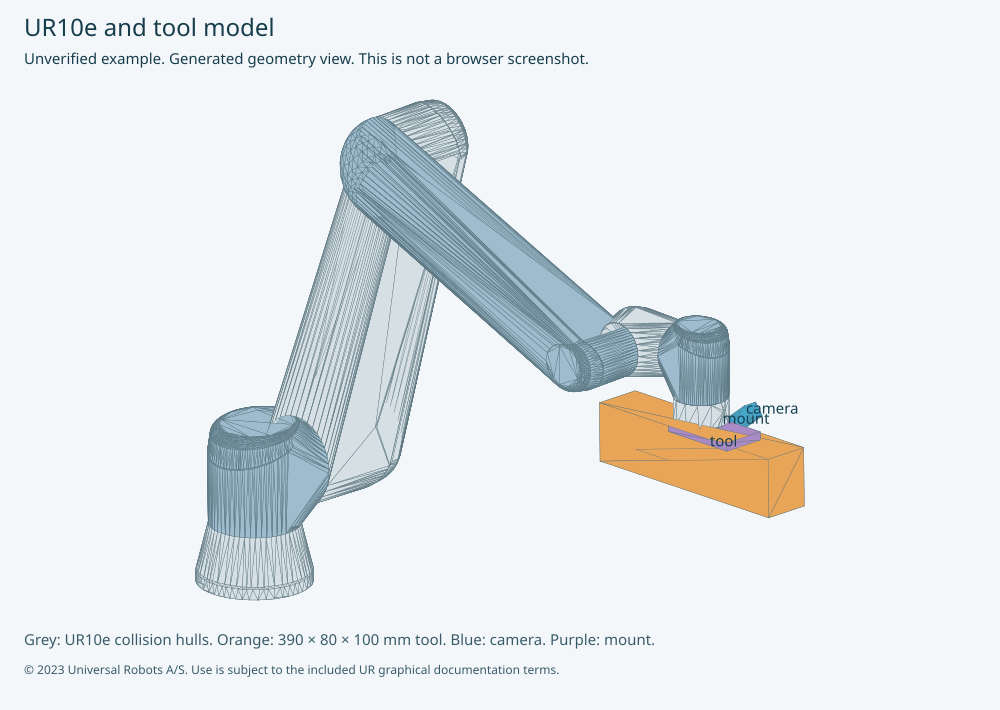
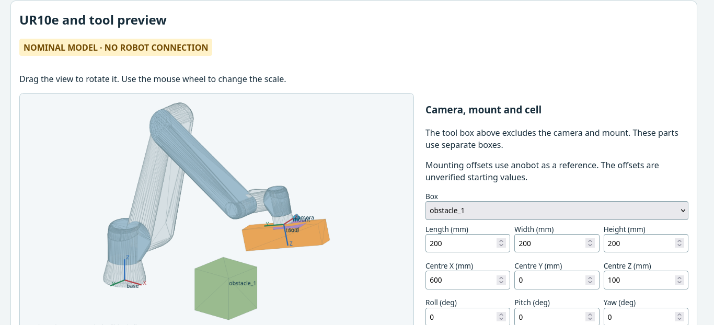

# UR10e preview and calibration path checks

This review adds a complete nominal arm to the tool editor. The camera and mount
use separate editable boxes. Calibration checks each proposed joint path,
including probes, intermediate returns, updated plans and the final return.
The original 25 degree tilt and 30 degree roll settings are visible in Setup.
The live bench has not received these changes.



This image is a generated geometry view. It is not a browser screenshot.

## Use the preview

1. Select **Open tool box draft** in Setup.
2. Scroll to **UR10e and tool preview**.
3. Drag the view to rotate it. Use the wheel to change the scale.
4. Edit the tool dimensions and flange pose in the first panel.
5. Select **camera** or **mount** to edit its box and flange pose.
6. Add measured cell boxes for the table, board, dummy and nearby objects.
7. Enter the measured model uncertainty and required clearance.
8. Export the collision scene to a new JSON file.

Joint fields change the displayed pose only. They do not send robot commands.
The canvas also supports arrow keys and plus/minus keys. A saved calibration
`session.json` displays its joint segments, including returns. A checked-plan
file displays its recorded results. Any scene change invalidates matching results.

The nominal arm data comes from UR description version 4.3.1. It uses controller
`base` coordinates and the zero-TCP `tool0` frame. The visual and numeric checks
use the same exported kinematics and link hulls. The existing simulator's
independent DH model matches this export in the offline tests.

The starting tool is 390 by 80 by 100 mm. Its centre is [0, 0, 50] mm from
`tool0`. Its example yaw is 90 degrees, so its long axis follows flange Y.
This uses the anobot long-axis direction as a reference. It is not a measured
mounting transform. Roll, pitch and yaw use Rz(yaw) × Ry(pitch) × Rx(roll).
These angles are not UR rotation-vector coordinates.

The anobot camera attachment uses [98.60, 10.98, 8.68] mm and
[90, -52.59, -90] degrees. The example camera box also includes the nominal
camera-body offset from the screw mount. Its body size is 25.05 by 90 by 25 mm.
The adapter box encloses the referenced adapter mesh, including its nominal
origin. The reference mesh does not prove the installed adapter's size or pose.
The user confirmed that the tool box excludes the camera and mount.

## Check a saved path without hardware

Install the package's `collision` extra in a separate review environment.
The checker uses NumPy and SciPy's HiGHS solver. It requires no ROS runtime,
RTDE session, robot address or camera.

```bash
python -m ur_handeye.collision \
  --scene collision-scene.json \
  --plan saved-session/session.json \
  --output checked-plan.json
```

The output file must be new. Open it through **Path file** in the preview.
A failure preserves the proposed segments and the affected bodies in the report.
The saved-session adapter reconstructs its planned view and return segments.
It does not invent probe or interim-plan history absent from the saved file.
The live collector records those separate checks in session metadata. It also
saves each stage as `collision-plan-001.json`, `collision-plan-002.json` and
subsequent files. Open a stage file directly to inspect probes or updated plans.

The old `tool_bounding_box` JSON remains a visualization draft. It cannot replace
a `ur10e_collision_scene` file. The collision scene includes a robot-model hash,
three attached boxes, cell boxes, model uncertainty and confirmation fields.
Changing geometry in the editor resets both physical and cell confirmation.
The example keeps both fields false and has no measured cell obstacles.

## How the check works

The checker encloses each UR collision mesh in a convex hull. Tool, camera,
adapter and cell geometry use oriented boxes. A fast box test can establish a
separating plane. When that test is inconclusive, a linear program proposes a
plane between the tighter hulls. The checker then evaluates that plane against
every vertex. A solver result alone never establishes clearance.

For each joint interval, the checker bounds every body's motion about the
relevant joint axes. It cancels shared upstream rigid motion for body pairs.
A midpoint must have more separation than that motion bound, the configured
clearance, both bodies' uncertainty and a 0.2 degree joint tracking allowance.
Otherwise, the checker divides the interval and repeats. Solver failures,
depth limits and unresolved intervals refuse the path. It never accepts a path
solely because both endpoints are clear.

Adjacent arm links meet at joints and do not form tested pairs. The attached
tool/camera/mount share a rigid frame and do not form internal tested pairs.
The tool and mount contact wrist 3 at their fixed mounting interface. Those
two entire body pairs are excluded, not only their contact patches. A clear result
does not establish clearance for those pairs. Camera-to-wrist-3 remains checked. All three
attachments remain checked against wrist 1, wrist 2, the other arm links and
cell boxes. Review the fixed contact assumptions against the physical model.

The result `clear_in_model` means that the modeled interval meets these bounds.
`collision` means that proxy geometry cannot meet the required clearance.
It does not prove that the physical parts touched. Convex hulls and boxes can
reject a physically clear path through a concave space. `unresolved` and
`unavailable` also refuse motion. The checker does not calculate detours.

## Automatic calibration

The new review CLI refuses automatic collection and replay before robot or
camera access until it receives a confirmed physical model and measured cell.
Setup accepts that exported scene through **Collision scene JSON**. A dry run
can inspect an unconfirmed model, but it still opens the existing RTDE planning
interface and camera. The standalone command above is the hardware-free option.

The collector checks the entire plan before asking the operator to move. It
records checks for each probe return, initial view plan, updated view plan and
replay return. The robot adapter checks the actual start-to-target path again
before each `moveJ`. It refuses a moving start, changed starting joints or a
flange FK mismatch. Controller reachability and existing stop checks remain.
FK consistency at the start, middle and target is a diagnostic. It does not
establish a physical error bound for every arm link.

The supported motion is a stopped, unblended, linear joint-space move. These
checks do not cover Cartesian `moveL`, blends, force moves, freedrive, braking
trajectories or controller modes with a different path. A fixed-camera automatic
calibration also needs a different attachment model and is refused here.
Manual capture does not gain collision protection for pendant motion.

The Marker Pick Teacher includes the same visual editor. Its motion paths do
not use the new checker. Teacher Cartesian stages and return-to-observation
integration remain open work. Interface PC planning ownership stays unchanged.

## Review evidence and next checks

Offline checks include nominal FK, known separation and containment, a collision
between clear endpoints, attachment-to-arm contact, motion bounds, invalid
profiles, missing dependencies and automatic refusal before hardware access.
The example simulation generates 14 views at the original angles. Its 29 view
and return paths pass in the example model. The example scene remains unconfirmed.

Node tests exercise the editor scripts with a DOM double. A headless Firefox review
exercised the local calibration file and the teacher HTTP editor with an inert service.
The review covered scene and joint edits, view controls, import/export, invalid input,
confirmation reset, saved paths and stage selection. The screenshot below is from
that browser review. No attended hardware trial occurred.



Before a live trial, verify the robot-specific arm model, all assembly coverage,
mounting transforms, cell geometry, payload, uncertainty and motion mode.
Do not mark the example confirmed merely to make a command pass.
The software checker is not a controller safety function or a certified safeguard.

Sources: [UR joint moves](https://www.universal-robots.com/manuals/EN/HTML/SW10_10/Content/prod-scriptmanual/all_scripts/movej_qa14v105t0r.htm),
[UR description](https://github.com/UniversalRobots/Universal_Robots_ROS2_Description),
[anobot reference](https://github.com/khkoh23/anobot/tree/82206d330cf300db9b24aa9f24b2633a92e9db8f),
[RealSense camera body](https://github.com/realsenseai/realsense-ros/blob/ros2-master/realsense2_description/urdf/_d435.urdf.xacro),
[SciPy HiGHS interface](https://docs.scipy.org/doc/scipy/reference/optimize.linprog-highs.html).
The included `UR-MODEL-NOTICE.txt` contains the UR graphical documentation terms.
